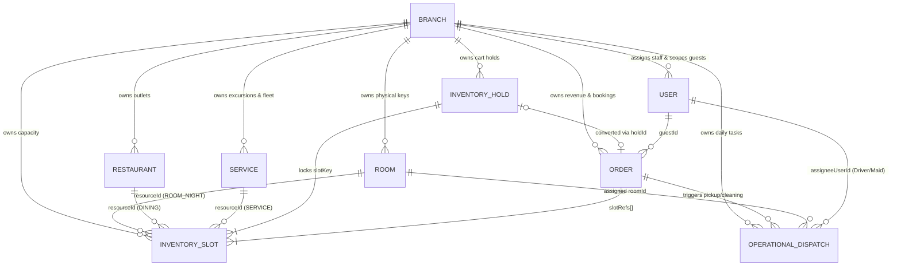
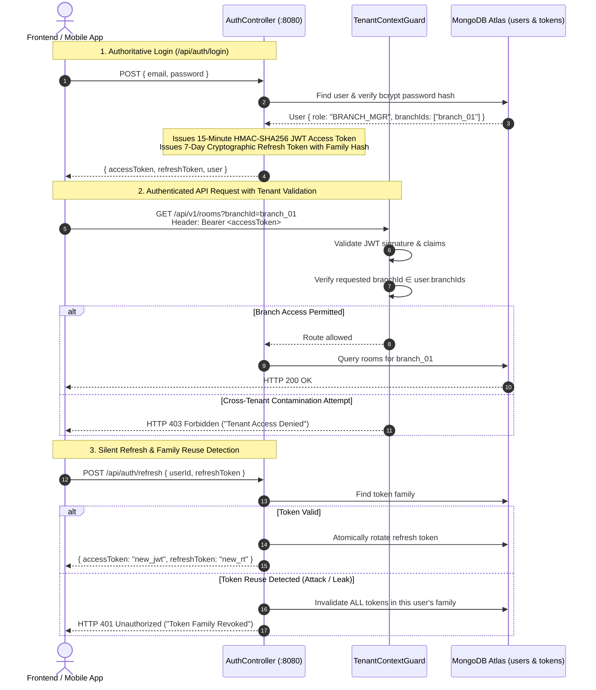
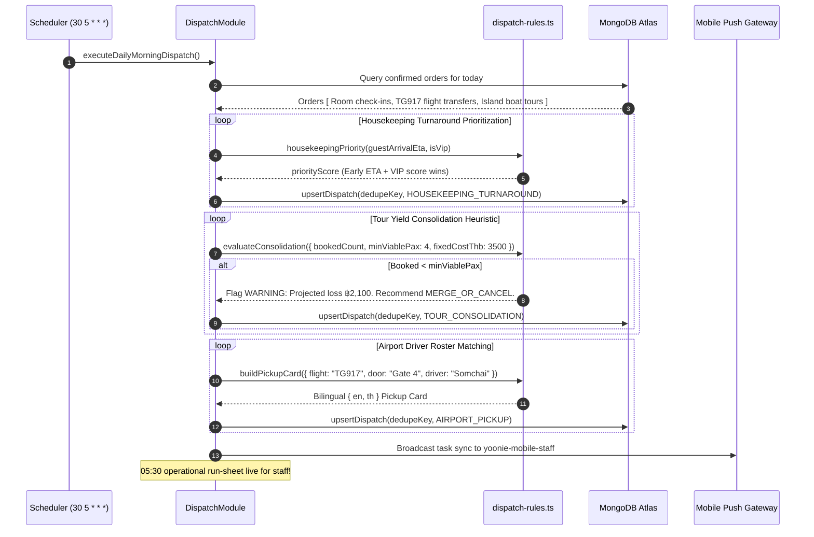
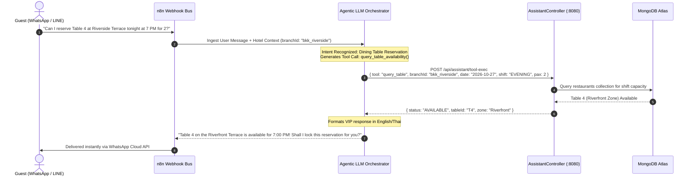
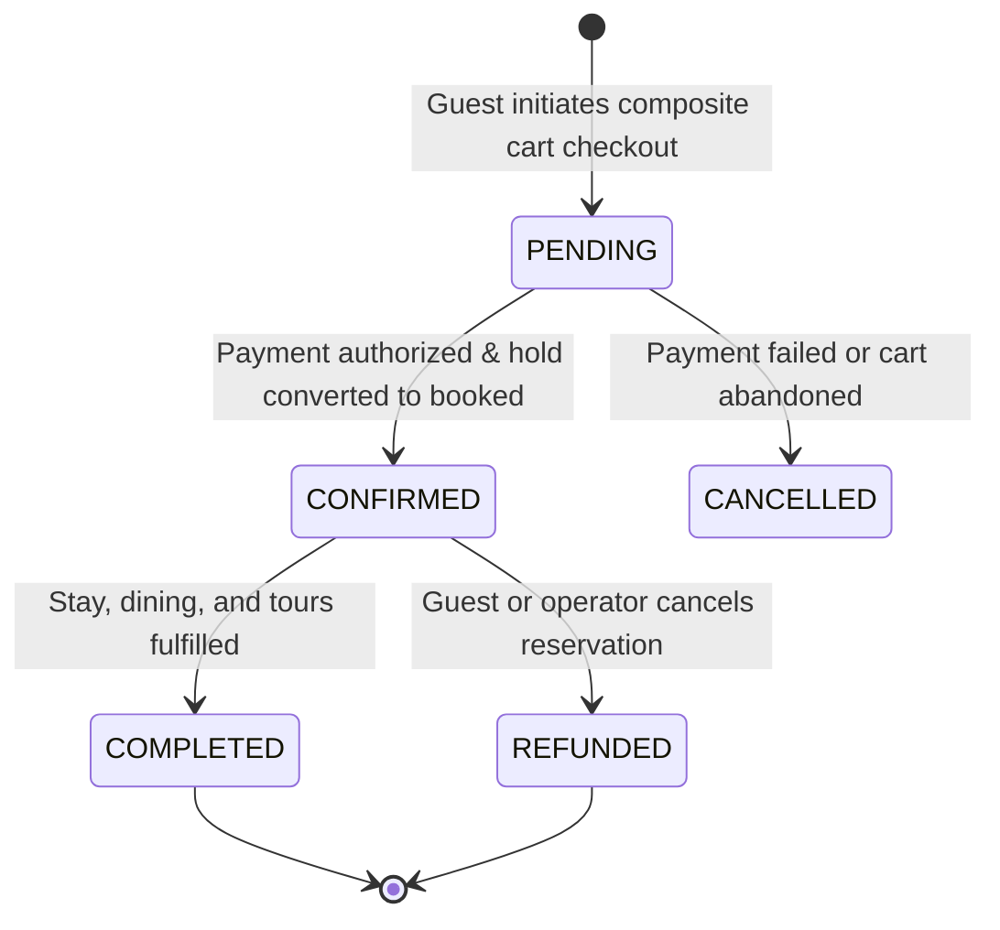
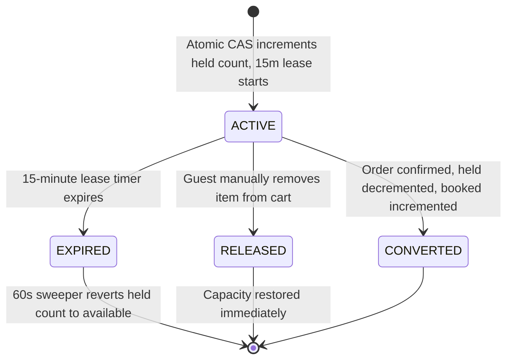
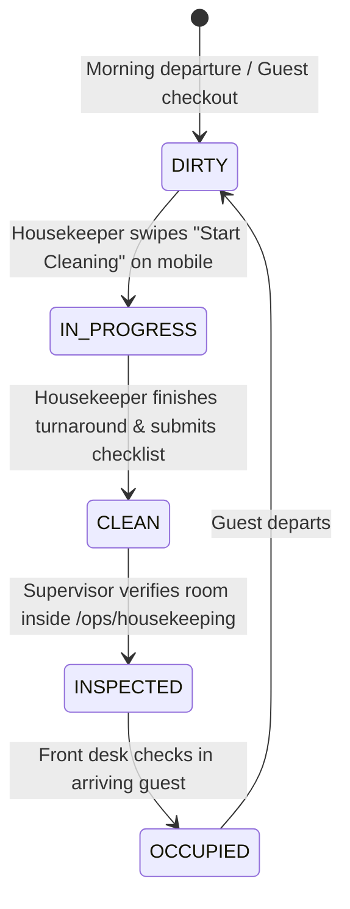
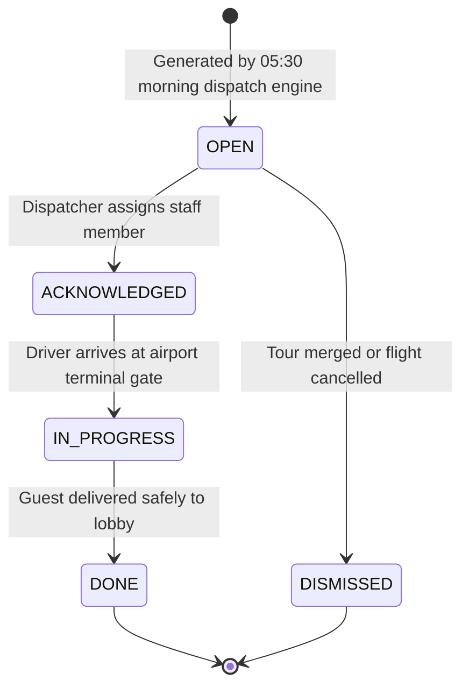

# Yoonie Backend — Architecture & System Engine

A unified hospitality operating system for independent boutique hotels and multi-service operators — direct booking plus operational dispatch, in one native multi-tenant data model.

This repository is built with **NestJS 10**, **Express**, **MongoDB Atlas (Native Driver / Mongoose)**, **TypeScript**, and **n8n Webhook Orchestration**.

---

## 1. Master Backend Architecture Topology

```
========================================================================================================================
                              YOONIE BACKEND DISTRIBUTED ARCHITECTURE & EXECUTION FLOW
========================================================================================================================

    [ Inbound Ingress via Vercel Edge / Cloudflare Anycast ]
    Headers: Authorization: Bearer <JWT> | Idempotency-Key: <UUID> | X-Tenant-Slug / Host: sedona.yoonie.app
                               │
                               ▼
┌──────────────────────────────────────────────────────────────────────────────────────────────────────────────────────┐
│ ZERO-TRUST SECURITY & AUTHORIZATION PIPELINE                                                                         │
│                                                                                                                      │
│  1. Rate Limiting:        ThrottlerGuard (Token bucket rate limiter: 120 req/min per IP/Tenant)                       │
│  2. Identity:             JwtAuthGuard (Validates 15-minute HMAC-SHA256 JWT access token)                            │
│  3. Refresh Rotation:     /api/auth/refresh (Rotates 7-day cryptographic refresh token; revokes family on reuse)     │
│  4. Tenant Isolation:     TenantContextGuard (Enforces request.branchId ∈ user.branchIds; zero data leakage)        │
│  5. 5-Tier RBAC Matrix:   RolesGuard (@Roles: ADMIN > BRANCH_MGR > DISPATCHER > STAFF > GUEST)                       │
│  6. Idempotency Lock:     IdempotencyInterceptor (Deduplicates mutation requests via atomic UUID locking)           │
└──────────────────────────────────────────────────────────┬───────────────────────────────────────────────────────────┘
                                                           │
                                                           ▼
┌──────────────────────────────────────────────────────────────────────────────────────────────────────────────────────┐
│ 14 MODULAR NESTJS BOUNDED CONTEXT DOMAINS                                                                            │
│                                                                                                                      │
│  ┌─────────────────────────┐  ┌─────────────────────────┐  ┌─────────────────────────┐  ┌─────────────────────────┐  │
│  │ AuthModule              │  │ BranchModule            │  │ RoomModule              │  │ RestaurantModule        │  │
│  │ User identity, bcrypt,  │  │ Multi-tenant property   │  │ Physical room keys,     │  │ F&B outlets, seating    │  │
│  │ JWT & refresh families  │  │ rules, tax & timezones  │  │ cleaning status board   │  │ shifts & table configs  │  │
│  └─────────────────────────┘  └─────────────────────────┘  └─────────────────────────┘  └─────────────────────────┘  │
│  ┌─────────────────────────┐  ┌─────────────────────────┐  ┌─────────────────────────┐  ┌─────────────────────────┐  │
│  │ ServiceModule           │  │ InventoryModule         │  │ OrderModule             │  │ DispatchModule          │  │
│  │ Excursions, boat tours, │  │ Atomic CAS allocation & │  │ Composite cart checkout │  │ 05:30 morning dispatch  │  │
│  │ spa & fleet catalog     │  │ 15-min hold leases      │  │ with UTM attribution    │  │ runner & transit engine │  │
│  └─────────────────────────┘  └─────────────────────────┘  └─────────────────────────┘  └─────────────────────────┘  │
│  ┌─────────────────────────┐  ┌─────────────────────────┐  ┌─────────────────────────┐  ┌─────────────────────────┐  │
│  │ StaffModule             │  │ DevicesModule           │  │ NotificationsModule     │  │ AssistantModule         │  │
│  │ Frontline mobile staff  │  │ Mobile FCM device token │  │ WhatsApp Cloud API &    │  │ AI Concierge & tool     │  │
│  │ rosters (drivers/maids) │  │ registry for push sync  │  │ LINE official webhooks  │  │ execution orchestrator  │  │
│  └─────────────────────────┘  └─────────────────────────┘  └─────────────────────────┘  └─────────────────────────┘  │
└───────────────────────────────┬──────────────────────────────────────────────────────────┬───────────────────────────┘
                                │                                                          │
                                ▼                                                          ▼
┌──────────────────────────────────────────────────────────────┐  ┌────────────────────────────────────────────────────┐
│ CONCURRENCY, ATOMIC LOCKING & PERSISTENCE TIER               │  │ ASYNC ORCHESTRATION & NOTIFICATION CHANNELS        │
│                                                              │  │                                                    │
│  • Atomic CAS Inventory Decrement ($inc with precondition):  │  │  • n8n Webhook Cluster:                            │
│    findOneAndUpdate({ slotId, available: { $gte: qty } },    │  │    Event dispatcher for async external systems     │
│                     { $inc: { available: -qty, held: +qty } })│  │                                                    │
│  • 15-Min TTL Hold Sweeper (CRON: * * * * *):                │  │  • Agentic AI Concierge Pipeline:                  │
│    Finds expired unpurchased holds and reverts capacity      │  │    Real-time tool execution against database       │
│  • 05:30 Morning Dispatch Runner (CRON: 30 5 * * *):         │  │    (Availability queries, booking verification)    │
│    Pre-computes airport driver manifests and housekeeping    │  │                                                    │
│  • MongoDB Atlas Multi-Tenant Replica Set Cluster:           │  │  • Multi-Channel Gateway:                          │
│    Single database with compound indexing: { branchId, ... } │  │    WhatsApp Business API • LINE Official • Google  │
│    Full multi-document ACID transactions                     │  │    FCM Push (yoonie-mobile-staff) • Twilio SMS     │
└──────────────────────────────────────────────────────────────┘  └────────────────────────────────────────────────────┘
```

---

## 2. Complete 9-Collection Schema & Compound Index Matrix

All 9 collections reside in a single MongoDB database partitioned logically by `branchId` (tenant isolation).

```
┌──────────────────────────────────────────────────────────────────────────────────────────────────────────────────────┐
│ MONGODB 9-COLLECTION MULTI-TENANT SCHEMA & INDEX TOPOLOGY                                                            │
└──────────────────────────────────────────────────────────────────────────────────────────────────────────────────────┘

  1. branches (Tenant Configurations & Operational Policies)
     ├── _id: ObjectId
     ├── code: String [UNIQUE] (e.g. "BKK-RIVERSIDE")
     ├── name: String ("Sedona Hotel & Resort")
     ├── slug: String [UNIQUE] ("sedona")
     ├── timezone: String ("Asia/Bangkok")
     ├── currency: String ("THB")
     └── settings: Object { vatRate, serviceChargeRate, holdTtlMinutes: 15, dispatchGenerationTime: "05:30" }
     └── INDEXES: { slug: 1 } [UNIQUE], { code: 1 } [UNIQUE]

  2. users (Unified Identities: Guests, Staff, Supervisors & Owners)
     ├── _id: ObjectId
     ├── email: String [UNIQUE]
     ├── passwordHash: String (Bcrypt)
     ├── role: Enum ["ADMIN", "BRANCH_MGR", "DISPATCHER", "STAFF", "GUEST"]
     ├── branchIds: Array<ObjectId> (Multi-tenant property memberships)
     ├── jobTitle: Enum ["DRIVER", "HOUSEKEEPER", "BUTLER", "CONCIERGE"]
     ├── phoneE164: String ("+66810000001")
     ├── lineUserId: String / whatsappOptIn: Boolean
     ├── stats: Object { lifetimeSpendThb, stayCount, orderCount }
     └── vipScore: Number (0 to 100, drives housekeeping priority)
     └── INDEXES: { email: 1 } [UNIQUE], { branchIds: 1, role: 1 }, { phoneE164: 1 }

  3. rooms (Physical Keys & Housekeeping Turnover Board)
     ├── _id: ObjectId
     ├── branchId: ObjectId [FK -> branches._id]
     ├── roomNumber: String ("101", "PV2")
     ├── roomType: Enum ["STANDARD_KING", "DELUXE_BALCONY", "POOL_VILLA"]
     ├── cleaningStatus: Enum ["DIRTY", "IN_PROGRESS", "CLEAN", "INSPECTED"]
     ├── floor: Number
     └── isSmoking: Boolean / activeTask: ObjectId [FK -> operational_dispatches._id]
     └── INDEXES: { branchId: 1, roomNumber: 1 } [UNIQUE], { branchId: 1, cleaningStatus: 1 }

  4. restaurants (F&B Outlets, Shifts & Table Configs)
     ├── _id: ObjectId
     ├── branchId: ObjectId [FK -> branches._id]
     ├── code: String ("RIV-TERRACE")
     ├── name: String ("Riverside Terrace")
     ├── tables: Array<{ tableId, capacity, zone: "INDOOR" | "OUTDOOR" | "RIVERFRONT" }>
     └── shifts: Array<{ shiftName: "BREAKFAST" | "ALL_DAY" | "EVENING", startsAt, endsAt }>
     └── INDEXES: { branchId: 1, code: 1 } [UNIQUE]

  5. services (Experiences, Tours, Airport Fleet & Wellness)
     ├── _id: ObjectId
     ├── branchId: ObjectId [FK -> branches._id]
     ├── code: String ("TOUR-ISLANDS")
     ├── category: Enum ["TOURS", "WELLNESS", "TRANSPORT"]
     ├── kind: Enum ["AIRPORT_TRANSFER", "SCHEDULED_TOUR", "SPA_TREATMENT"]
     ├── pricing: Object { basePriceThb, minViablePax: 4, fixedCostThb: 3500 }
     └── vehicles: Array<{ vehicleId, plateNumber, capacity, defaultDriverId }>
     └── INDEXES: { branchId: 1, code: 1 } [UNIQUE], { branchId: 1, category: 1 }

  6. inventory_slots (Atomic Unit of Bookable Capacity)
     ├── _id: ObjectId
     ├── slotKey: String [UNIQUE] ("branch_01:ROOM_NIGHT:DELUXE:2026-10-27")
     ├── branchId: ObjectId [FK -> branches._id]
     ├── kind: Enum ["ROOM_NIGHT", "DINING", "SERVICE"]
     ├── resourceId: ObjectId [FK -> rooms / restaurants / services]
     ├── startsAt: Date / endsAt: Date
     ├── capacity: Number (Maximum physical slots)
     ├── held: Number (Temporary 15-minute cart holds)
     └── booked: Number (Confirmed paid orders)
     └── INDEXES: { slotKey: 1 } [UNIQUE], { branchId: 1, kind: 1, startsAt: 1 }

  7. inventory_holds (15-Minute Temporary Soft Holds)
     ├── _id: ObjectId
     ├── branchId: ObjectId [FK -> branches._id]
     ├── cartId: String (Client session UUID)
     ├── lines: Array<{ slotKey, quantity }>
     ├── status: Enum ["ACTIVE", "CONVERTED", "RELEASED", "EXPIRED"]
     ├── expiresAt: Date (NOW + 15 minutes)
     └── purgeAt: Date (MongoDB TTL index: automatically deletes document)
     └── INDEXES: { cartId: 1 }, { branchId: 1, status: 1, expiresAt: 1 }, { purgeAt: 1 } [TTL: 0s]

  8. orders (Composite Multi-Item Guest Reservations)
     ├── _id: ObjectId
     ├── branchId: ObjectId [FK -> branches._id]
     ├── orderNumber: String [UNIQUE] ("ORD-20261027-001")
     ├── guestId: ObjectId [FK -> users._id]
     ├── holdId: ObjectId [FK -> inventory_holds._id]
     ├── status: Enum ["PENDING", "CONFIRMED", "CANCELLED", "COMPLETED"]
     ├── idempotencyKey: String [UNIQUE] (UUID from client header)
     ├── items: Array<{
     │     kind: "STAY" | "DINING" | "SERVICE",
     │     amountThb: Number,
     │     assignedRoomId: ObjectId,
     │     flightInfo: { flightNumber, scheduledArrival, airportDoor },
     │     status: "PENDING" | "CONFIRMED" | "CANCELLED"
     │   }>
     ├── totalAmountThb: Number
     └── attribution: Object { utmSource, utmMedium, utmCampaign, channel: "DIRECT" | "OTA" }
     └── INDEXES: { branchId: 1, orderNumber: 1 } [UNIQUE], { idempotencyKey: 1 } [UNIQUE], { branchId: 1, status: 1 }

  9. operational_dispatches (Automated Daily 05:30 Run-Sheet)
     ├── _id: ObjectId
     ├── branchId: ObjectId [FK -> branches._id]
     ├── serviceDate: String ("2026-10-27")
     ├── type: Enum ["HOUSEKEEPING_TURNAROUND", "TOUR_CONSOLIDATION", "AIRPORT_PICKUP"]
     ├── priorityScore: Number (Computed dynamic score: earlier ETA + VIP status)
     ├── status: Enum ["OPEN", "ACKNOWLEDGED", "IN_PROGRESS", "DONE", "DISMISSED"]
     ├── assigneeUserId: ObjectId [FK -> users._id] (Driver / Housekeeper)
     ├── dedupeKey: String [UNIQUE] (branchId:serviceDate:type:key — ensures idempotent cron runs)
     └── payload: Object {
           roomId, roomNumber, incomingGuestName, flightNumber, meetingDoor,
           fillRate, minViablePax, projectedLossThb, recommendation
         }
     └── INDEXES: { dedupeKey: 1 } [UNIQUE], { branchId: 1, serviceDate: 1, status: 1, priorityScore: -1 }
```

---

## 3. Entity-Relationship Diagram (ERD)



---

## 4. Backend Execution Sequence Flows

### A. Zero-Trust Authentication & Token Family Rotation


### B. High-Concurrency CAS Inventory Decrement & 15-Minute Hold Release

```mermaid
sequenceDiagram
    autonumber
    actor GuestA as Guest A (Mobile)
    actor GuestB as Guest B (Web)
    participant API as InventoryController
    participant DB as MongoDB Atlas
    participant Sweeper as 60-Sec Cron Sweeper

    Note over GuestA,GuestB: Final Pool Villa Available (Capacity: 1, Held: 0, Booked: 0)

    par Parallel Hold Request
        GuestA->>API: POST /api/inventory/hold { slotKey, qty: 1 }
        GuestB->>API: POST /api/inventory/hold { slotKey, qty: 1 }
    end

    rect rgb(20, 30, 45)
        Note over API,DB: Atomic CAS: findOneAndUpdate({ slotKey, available: { $gte: 1 } }, { $inc: { held: +1 } })
        API->>DB: Execute Atomic CAS for Guest A
        DB-->>API: Slot Updated: Available 1 -> 0, Held 0 -> 1
        API->>DB: insertOne(inventory_holds, { cartId, status: "ACTIVE", expiresAt: NOW + 15m })
        API-->>GuestA: HTTP 201 Created (Hold ID: hold_101)
    end

    rect rgb(45, 20, 25)
        API->>DB: Execute Atomic CAS for Guest B
        Note over DB: Precondition Failed: available is now 0!
        DB-->>API: null (Zero documents updated)
        API-->>GuestB: HTTP 409 Conflict ("Inventory Sold Out")
    end

    opt Guest A Abandons Checkout
        Note over Sweeper,DB: 15 Minutes Elapse Without Payment
        Sweeper->>DB: find({ status: "ACTIVE", expiresAt: { $lte: NOW } })
        DB-->>Sweeper: [ hold_101 ]
        Sweeper->>DB: updateOne({ slotKey }, { $inc: { held: -1 } })
        Sweeper->>DB: updateOne({ _id: hold_101 }, { $set: { status: "EXPIRED" } })
        Note over DB: Capacity returned to public pool automatically!
    end
```


### C. Automated 05:30 Morning Dispatch Run-Sheet Engine


### D. Grounded AI Concierge & Real-Time RAG Tool Loop


---

## 5. State Transition Machine Lifecycles

### A. Order Status State Machine


### B. Inventory Hold Lifecycle


### C. Room Cleaning Status Lifecycle


### D. Operational Dispatch Task Lifecycle


---

## 6. Local Setup & Verification

```bash
# 1. Install dependencies
npm install

# 2. Seed database with realistic multi-tenant hotel data (BKK-RIVERSIDE)
npm run seed

# 3. Start development server
npm run start:dev

# 4. Verify API health
curl http://localhost:8080/api/health
```

---

## 7. Documentation Index

Comprehensive guides, domain specifications, and operational manuals are maintained across the repository:

- [**`PRODUCT.md`**](./PRODUCT.md): Hospitality operating system vision, product-to-code mapping, invariants, and business rules.
- [**`docs/DATA_MODEL.md`**](./docs/DATA_MODEL.md): Full MongoDB Entity-Relationship Diagrams (ERD), schema field specifications, and state machine transitions.
- [**`docs/SYSTEM_FLOWS.md`**](./docs/SYSTEM_FLOWS.md): Detailed operational workflows and sequence diagrams for inventory holds, checkout, and morning dispatch.
- [**`docs/FRONTEND_API.md`**](./docs/FRONTEND_API.md): Exhaustive REST API contract with request/response schemas and TypeScript interfaces.
- [**`docs/MULTI_TENANCY.md`**](./docs/MULTI_TENANCY.md): Subdomain routing rules, logical multi-tenant partitioning, compound index strategy, and zero-leak access guards.
- [**`docs/OPERATING_RULES.md`**](./docs/OPERATING_RULES.md): Core hospitality business logic, checkout rules, cancellation policies, and inventory invariants.
- [**`docs/STORAGE.md`**](./docs/STORAGE.md): Cloudflare R2 object storage architecture, presigned upload URLs, and image delivery.
- [**`docs/LINE_SETUP.md`**](./docs/LINE_SETUP.md): LINE Official Account messaging integration and driver dispatch card setup.
- [**`n8n/README.md`**](./n8n/README.md): Webhook bus configuration, stateful workflow automation, and agentic AI concierge pipeline.
- [**`src/seed/seed.ts`**](./src/seed/seed.ts): Executable reference hotel implementation (`BKK-RIVERSIDE`, 40 rooms, 2 restaurants, 4 services, and realistic order book).
