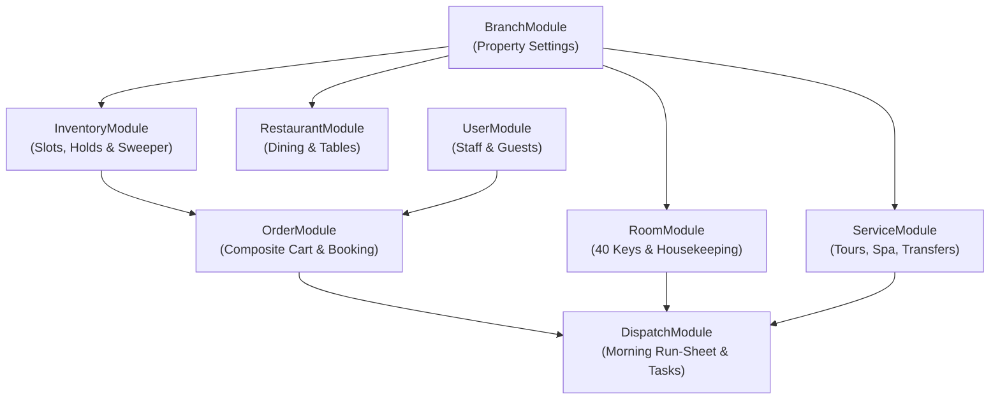

# Hospitality Platform Backend Architecture

## 1. Architectural Philosophy: Decoupled Domain Modules

Bundling all entities (`branch`, `room`, `restaurant`, `service`, `inventory`, `order`, `dispatch`) into a single monolithic `hospitality` module is an anti-pattern. It tightly couples disparate operational concerns, creates oversized dependency graphs, and breaks the modular NestJS architecture established by [`src/user`](./src/user) and [`src/auth`](./src/auth).

Instead, each operational concern is treated as an **independent, bounded domain module** with its own:
- **Module Definition** (`*.module.ts`)
- **Controller** (`*.controller.ts`) with Swagger OpenAPI specs
- **Service** (`*.service.ts`) with business logic and transactional safety
- **Repository** (`*.repo.ts`) isolating MongoDB/Mongoose queries
- **Entity / Schema** (`entity/*.entity.ts` or `schemas/*.schema.ts`)
- **Data Transfer Objects** (`dto/*.dto.ts`) with `class-validator` and `class-transformer`
- **Interfaces** (`interfaces/*.interface.ts`) defining explicit service and repository contracts

Shared primitives (such as timezone handling, business date algorithms, global guards, decorators, and system-wide enums) live strictly in `src/common/`.

---

## 2. Target Folder Structure

```
src/
├── main.ts
├── app.module.ts
│
├── auth/                             # Authentication & OAuth (Google, Discord, etc.)
│   ├── auth.module.ts
│   ├── auth.controller.ts
│   ├── auth.service.ts
│   ├── dto/
│   ├── interfaces/
│   └── strategies/
│
├── user/                             # User accounts, staff roles & master guest CDP
│   ├── user.module.ts
│   ├── user.controller.ts
│   ├── user.service.ts
│   ├── user.repo.ts
│   ├── entity/
│   │   └── user.entity.ts
│   ├── dto/
│   └── interfaces/
│
├── branch/                           # Property entity & tenant configurations
│   ├── branch.module.ts
│   ├── branch.controller.ts
│   ├── branch.service.ts
│   ├── branch.repo.ts
│   ├── entity/
│   │   └── branch.entity.ts          # Settings: hold TTL, consolidation threshold, timezone
│   ├── dto/
│   │   ├── create-branch.dto.ts
│   │   └── update-branch-settings.dto.ts
│   └── interfaces/
│
├── room/                             # Physical 40 keys & housekeeping operations
│   ├── room.module.ts
│   ├── room.controller.ts
│   ├── room.service.ts
│   ├── room.repo.ts
│   ├── entity/
│   │   └── room.entity.ts            # Physical units: CLEAN, DIRTY, IN_PROGRESS, INSPECTED
│   ├── dto/
│   │   ├── update-cleaning-status.dto.ts
│   │   └── block-room-range.dto.ts
│   └── interfaces/
│
├── restaurant/                       # F&B outlets, meal shifts & table zoning
│   ├── restaurant.module.ts
│   ├── restaurant.controller.ts
│   ├── restaurant.service.ts
│   ├── restaurant.repo.ts
│   ├── entity/
│   │   └── restaurant.entity.ts      # Riverside Cafe, Sunset Deck Bar, shifts, tables
│   ├── dto/
│   └── interfaces/
│
├── service/                          # Experience catalog (Tours, Spa, Transfers)
│   ├── service.module.ts
│   ├── service.controller.ts
│   ├── service.service.ts
│   ├── service.repo.ts
│   ├── entity/
│   │   └── service.entity.ts         # Cruise, Ayutthaya tour, Thai herbal massage, BKK transfer
│   ├── dto/
│   └── interfaces/
│
├── inventory/                        # Concurrency engine: atomic slots, holds, sweeper
│   ├── inventory.module.ts
│   ├── inventory.controller.ts
│   ├── inventory.service.ts
│   ├── inventory.repo.ts
│   ├── entity/
│   │   ├── inventory-slot.entity.ts  # ROOM_NIGHT, DINING, SERVICE sellable units
│   │   └── inventory-hold.entity.ts  # Soft reservation carts with TTL sweeper
│   ├── dto/
│   │   ├── create-hold.dto.ts
│   │   └── availability-query.dto.ts
│   └── interfaces/
│
├── order/                            # Booking engine & composite cart transactions
│   ├── order.module.ts
│   ├── order.controller.ts
│   ├── order.service.ts
│   ├── order.repo.ts
│   ├── entity/
│   │   └── order.entity.ts           # Multi-product items (Stay, Dining, Service), line lifecycles
│   ├── dto/
│   │   ├── create-order.dto.ts
│   │   ├── confirm-payment.dto.ts
│   │   └── cancel-order-line.dto.ts
│   └── interfaces/
│
├── dispatch/                         # Operational run-sheet & morning tasks
│   ├── dispatch.module.ts
│   ├── dispatch.controller.ts
│   ├── dispatch.service.ts
│   ├── dispatch.repo.ts
│   ├── rules/
│   │   └── dispatch-rules.ts         # Pure priority scoring, consolidation, bilingual cards
│   ├── entity/
│   │   └── operational-dispatch.entity.ts
│   ├── dto/
│   │   └── update-dispatch-status.dto.ts
│   └── interfaces/
│
├── mail/                             # Transactional email dispatcher
│   ├── mail.module.ts
│   └── mail.service.ts
│
├── mongo-client/                     # Database connection & connection logging
│   ├── mongo.module.ts
│   └── mongo.connection.logger.ts
│
└── common/                           # Global cross-cutting primitives
    ├── config/
    ├── decorators/
    ├── enums/
    │   ├── user-role.enum.ts         # ADMIN, BRANCH_MGR, DISPATCHER, STAFF, GUEST
    │   ├── room-type.enum.ts         # STANDARD_KING, DELUXE_BALCONY, POOL_VILLA
    │   ├── cleaning-status.enum.ts   # CLEAN, DIRTY, IN_PROGRESS, INSPECTED
    │   ├── service.enum.ts           # ServiceCategory, ServiceKind, PricingModel
    │   ├── order.enum.ts             # OrderStatus, LineStatus, LineKind
    │   ├── inventory.enum.ts         # SlotKind, SlotStatus, HoldStatus
    │   └── dispatch.enum.ts          # DispatchType, DispatchStatus, Severity, MessageChannel
    ├── filters/
    ├── guards/
    ├── helpers/
    │   └── time.helper.ts            # Asia/Bangkok business dates, zonedAt, hhmm, eachNight
    ├── interceptors/
    └── interfaces/
```

---

## 3. Domain Responsibility & Dependency Graph



### Module Boundaries:
1. **`RoomModule`** manages physical rooms and housekeeping state. It **never** computes room availability.
2. **`InventoryModule`** manages sellable slot units (`ROOM_NIGHT`, `DINING`, `SERVICE`) with atomic conditional `$inc` operations. It provides generic availability queries and holds to `OrderModule`.
3. **`OrderModule`** orchestrates composite bookings across stays, dining, and activities. Upon payment, it calls `InventoryModule.confirm()`.
4. **`DispatchModule`** reads data across `OrderModule`, `RoomModule`, and `ServiceModule` to generate idempotent morning run-sheets for housekeeping, airport pickups, and tour consolidation alerts.

---

## 4. Refactoring Step-by-Step Plan

To transition cleanly from the temporary bundled `hospitality` folder to the decoupled domain architecture:

1. **Move Common Enums & Helpers**:
   - Move domain enums into discrete files under `src/common/enums/`.
   - Move time algorithms into `src/common/helpers/time.helper.ts`.
2. **Create Standalone Feature Modules**:
   - `src/branch/`
   - `src/room/`
   - `src/restaurant/`
   - `src/service/`
   - `src/inventory/`
   - `src/order/`
   - `src/dispatch/`
3. **Migrate Entities & Services**:
   - Place each entity in its respective module directory.
   - Implement `*.repo.ts` and `*.service.ts` per domain with dedicated interfaces.
4. **Register in `AppModule`**:
   - Register the 7 domain modules individually in `src/app.module.ts`.
5. **Delete Temporary `src/hospitality/` Bundle**.
