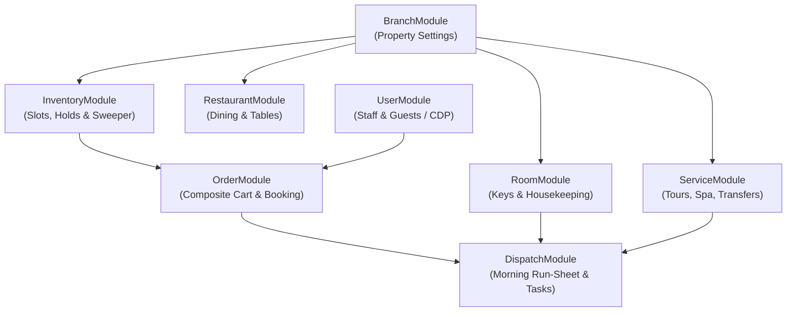
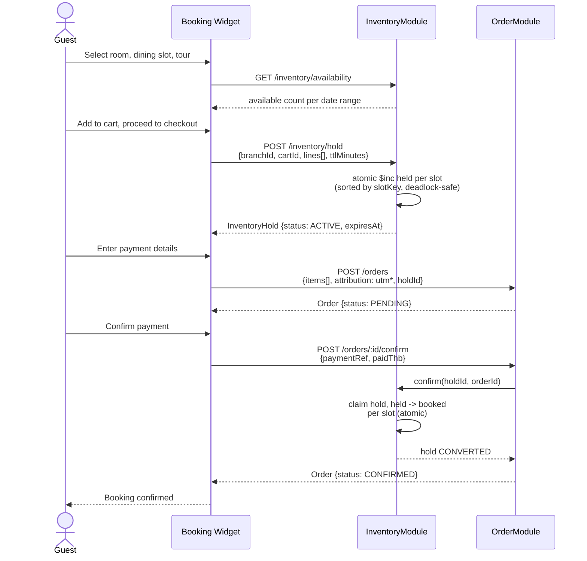
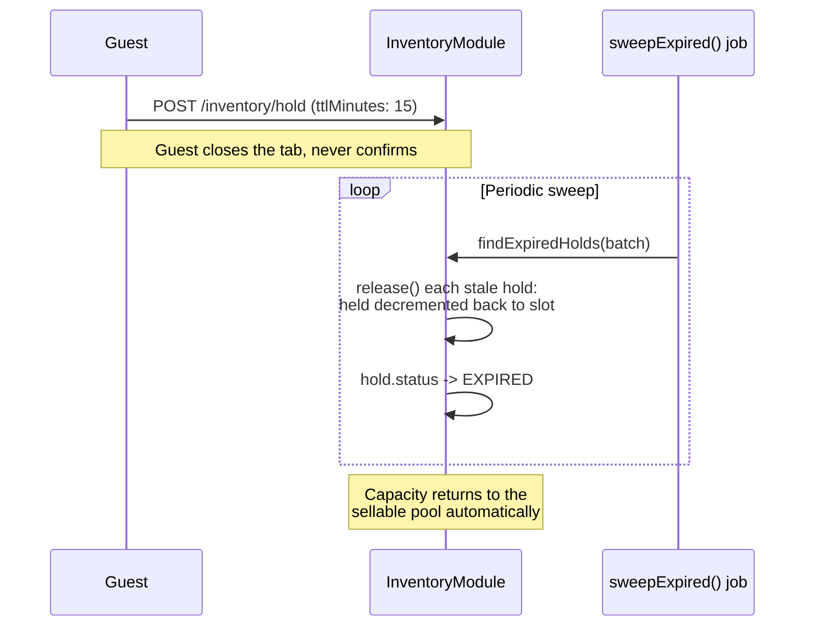
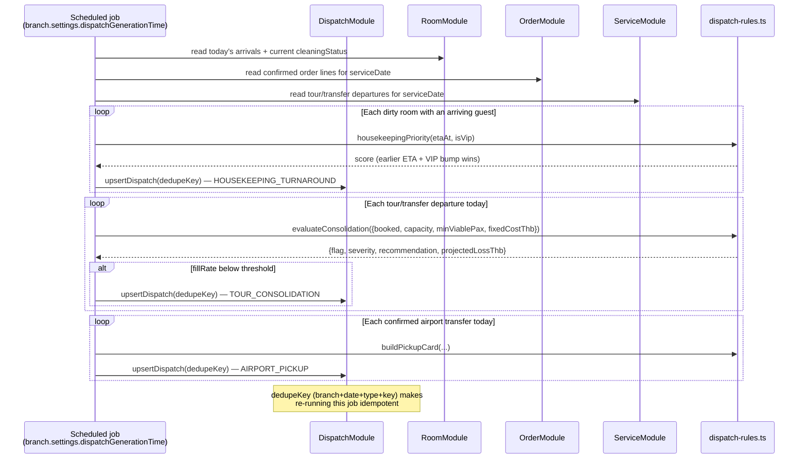
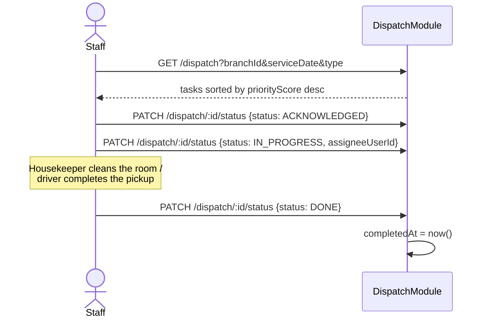
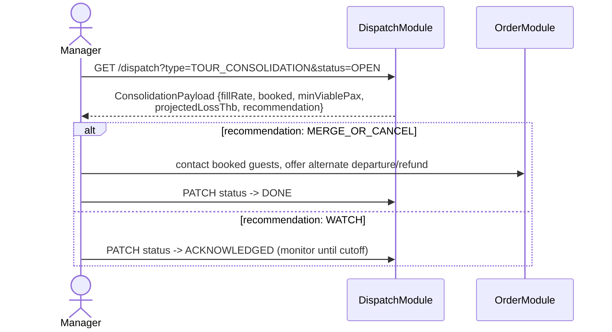
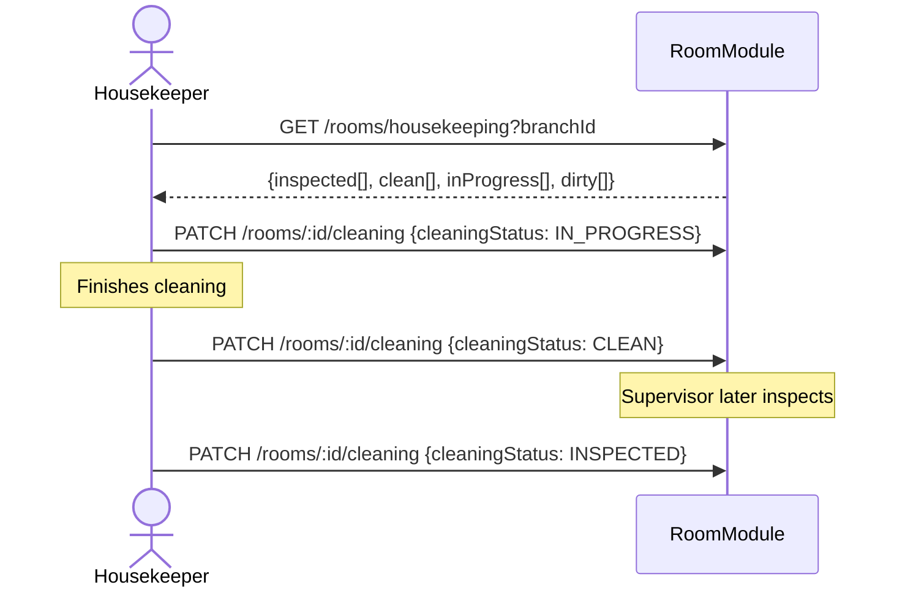

# Yoonie Backend

A unified hospitality operating system for independent boutique hotels and multi-service operators — direct booking plus operational dispatch, in one native data model.

This README is the high-level overview: who we are, the problem, the solution, what's offered, the schema, and the request flows for both guests and property owners/staff. For implementation-level detail see [`PRODUCT.md`](./PRODUCT.md) (product-to-code mapping, gaps, invariants) and [`docs/DATA_MODEL.md`](./docs/DATA_MODEL.md) (full entity-relationship and state diagrams).

---

## Who We Are

Yoonie is a unified hospitality operating system built specifically for independent boutique hotels and multi-service operators. We replace fragmented legacy software by bridging direct online booking with on-the-ground resource dispatch. By uniting accommodations, dining outlets, and guest experiences into a single native data architecture, we empower independent property owners to break free from high-commission Online Travel Agencies (OTAs), establish direct guest relationships, and run synchronized, high-margin frontline operations.

## Problem Statement

Independent hospitality businesses operate in an OTA hostage crisis and a state of severe internal fragmentation:

- **Margin erosion & lost ownership** — Operators surrender 15–25% of top-line revenue to third-party booking platforms (Booking.com, Agoda, Viator). In return, they receive masked guest contacts, zero customer-data ownership, and blind marketing spend with no direct conversion attribution.
- **The "volume vs. value" operational trap** — Properties spend disproportionate operational effort managing high-volume, low-margin transactions (F&B accounts for ~67% of transactional lines but only ~10% of revenue), while their primary revenue generators — rooms, tours, and transfers (~90% of revenue) — suffer from operational blind spots.
- **Siloed systems & experience friction** — Hotels run room bookings on legacy PMS, dining on disconnected POS terminals, and tours/airport transfers on paper clipboards or messaging apps. This disconnection causes severe operational friction: check-in delays average a low 3.1/5.0 customer satisfaction score, tour dissatisfaction reaches nearly 20% due to schedule rigidity, and over half of booking pipeline value is lost to unconfirmed reservations, cancellations, and no-shows.

## Solution

An end-to-end platform that captures first-party bookings at the digital front door and immediately synchronizes back-of-house operations:

- **Direct-Channel Sovereignty** — A lightweight, headless direct-booking engine embedded on the hotel's website lets guests reserve rooms, restaurant tables, excursions, and airport transfers in a single unified cart — eliminating OTA commissions and securing direct guest communication channels (WhatsApp and LINE).
- **Single Source of Operational Truth** — By standardizing customer identity, transactions, and marketing attribution into a centralized first-party data engine, the property tracks exact Return on Ad Spend (ROAS) and captures complete guest context prior to arrival.
- **Actionable Morning Dispatch** — Rather than passive historical dashboards, the system acts as an operational air-traffic controller: deterministic business logic turns live booking data into immediate, prioritized instructions for housekeeping, fleet drivers, and tour guides before doors open each morning.

## What We Offer

1. **Unified Multi-Service Booking Engine** — A seamless, embeddable checkout for the operator's website. Guests build a composite itinerary — a room stay, dining slots, excursions, airport transfers — in a single high-conversion transaction that logs source marketing campaigns (UTM parameters) natively.
2. **Master Guest CDP & Attribution Engine** — A centralized customer-data layer unifying guest identity across every touchpoint: verified phone numbers, messaging handles, flight details, and lifetime spend, giving full clarity on channel performance and campaign ROI.
3. **Front-Desk Zero Housekeeping Dispatch** — An automated room-turnaround queue that calculates cleaning urgency from inbound transit logistics and flight arrival windows, so rooms are cleaned in order of arriving guests, not room number.
4. **Fleet & Tour Yield Optimizer** — A capacity-management engine that flags under-viable tour/excursion departures hours before departure, saving fuel and crew overhead while protecting review sentiment.
5. **Automated Guest Transit Hub** — A proactive messaging microservice generating bilingual (English/Thai) airport pickup cards via WhatsApp and LINE, with terminal doors, driver details, and plate numbers.

---

## Architecture Overview

NestJS 11 on MongoDB/Mongoose, deployed to Vercel. Each operational concern is an independent, bounded domain module (`*.module.ts` / `*.controller.ts` / `*.service.ts` / `*.repo.ts` / `entity/` / `dto/`). Shared primitives (timezone handling, business-date math, guards, decorators, enums) live in `src/common/`.



**Module boundaries:**
1. `RoomModule` manages physical rooms and housekeeping state. It **never** computes availability.
2. `InventoryModule` manages sellable slot units (`ROOM_NIGHT`, `DINING`, `SERVICE`) via atomic conditional `$inc` operations — the entire concurrency model, used identically across every product type.
3. `OrderModule` orchestrates composite bookings across stays, dining, and activities. On payment, it calls `InventoryModule.confirm()`.
4. `DispatchModule` reads `OrderModule`, `RoomModule`, and `ServiceModule` to generate idempotent daily run-sheets (dedupe-keyed, safe to regenerate).

---

## Schema

Nine MongoDB collections. `Branch` is the tenant root; `Room`/`Restaurant`/`Service` are static catalogs; `InventorySlot`/`InventoryHold` are the concurrency engine; `Order` is the guest-facing booking; `OperationalDispatch` is the generated run-sheet.

```mermaid
erDiagram
    BRANCH ||--o{ USER : "staff assigned via branchIds"
    BRANCH ||--o{ ROOM : "owns"
    BRANCH ||--o{ RESTAURANT : "owns"
    BRANCH ||--o{ SERVICE : "owns"
    BRANCH ||--o{ INVENTORY_SLOT : "owns"
    BRANCH ||--o{ INVENTORY_HOLD : "owns"
    BRANCH ||--o{ ORDER : "owns"
    BRANCH ||--o{ OPERATIONAL_DISPATCH : "owns"

    ROOM ||--o{ INVENTORY_SLOT : "resourceId (kind=ROOM_NIGHT)"
    RESTAURANT ||--o{ INVENTORY_SLOT : "resourceId (kind=DINING)"
    SERVICE ||--o{ INVENTORY_SLOT : "resourceId (kind=SERVICE)"
    SERVICE }o--o{ USER : "vehicles[].defaultDriverId"

    INVENTORY_HOLD ||--|{ INVENTORY_SLOT : "lines[].slotKey (held qty)"
    INVENTORY_HOLD |o--o| ORDER : "claimed by, via order.holdId"

    USER ||--o{ ORDER : "guestId"
    ORDER ||--|{ ORDER_LINE : "items[]"
    ORDER_LINE }o--o| ROOM : "stay.assignedRoomId"
    ORDER_LINE }o--o| RESTAURANT : "dining.restaurantId"
    ORDER_LINE }o--o| SERVICE : "service.serviceId"
    ORDER_LINE }o--o{ INVENTORY_SLOT : "slotRefs[].slotKey"

    ORDER ||--o{ OPERATIONAL_DISPATCH : "orderId"
    ROOM ||--o{ OPERATIONAL_DISPATCH : "roomId"
    SERVICE ||--o{ OPERATIONAL_DISPATCH : "serviceId"
    USER ||--o{ OPERATIONAL_DISPATCH : "assigneeUserId / driverUserId"

    BRANCH {
        string code UK
        string timezone
        string currency
        object settings "vatRate / serviceChargeRate / holdTtlMinutes / consolidationThreshold / dispatchGenerationTime"
    }
    USER {
        string email UK
        string role "user / admin / BRANCH_MGR / DISPATCHER / STAFF / GUEST"
        string phoneE164
        string lineUserId
        bool whatsappOptIn
        object stats "lifetimeSpendThb / stayCount / orderCount"
        number vipScore
    }
    ROOM {
        string roomNumber UK_per_branch
        string roomType "STANDARD_KING / DELUXE_BALCONY / POOL_VILLA"
        string cleaningStatus "CLEAN / DIRTY / IN_PROGRESS / INSPECTED"
    }
    RESTAURANT {
        string code UK_per_branch
        object_array tables
        object_array shifts
    }
    SERVICE {
        string code UK_per_branch
        string category "TOURS / WELLNESS / TRANSPORT"
        string kind "AIRPORT_TRANSFER / SCHEDULED_TOUR / SPA_TREATMENT"
    }
    INVENTORY_SLOT {
        string slotKey UK "branch+kind+resourceKey+startsAt"
        string kind "ROOM_NIGHT / DINING / SERVICE"
        number capacity
        number held
        number booked
    }
    INVENTORY_HOLD {
        string cartId
        object_array lines "slotKey + qty"
        string status "ACTIVE / CONVERTED / RELEASED / EXPIRED"
        date expiresAt
        date purgeAt "TTL index"
    }
    ORDER {
        string orderNumber UK
        string status "PENDING / CONFIRMED / CANCELLED / COMPLETED"
        object attribution "utmSource + utmCampaign + channel"
        string idempotencyKey UK
    }
    ORDER_LINE {
        string kind "STAY / DINING / SERVICE"
        string status "PENDING / CONFIRMED / CANCELLED / COMPLETED / NO_SHOW"
    }
    OPERATIONAL_DISPATCH {
        string type "HOUSEKEEPING_TURNAROUND / TOUR_CONSOLIDATION / AIRPORT_PICKUP"
        string severity "INFO / WARN / CRITICAL"
        string status "OPEN / ACKNOWLEDGED / IN_PROGRESS / DONE / DISMISSED"
        string dedupeKey UK_per_branch_date_type
    }
```

Full field-level schema and all five state diagrams (Order, OrderLine, InventorySlot, InventoryHold, Room, Dispatch) live in [`docs/DATA_MODEL.md`](./docs/DATA_MODEL.md).

---

## Guest-Facing Flows

### Booking a composite itinerary (room + dining + tour)



Every order carries `attribution` (UTM source/medium/campaign/channel) captured at the point of booking — this is the mechanism behind direct-booking ROI tracking against OTA dependence.

### What happens if the guest abandons checkout



### Airport pickup (transit hub)

```mermaid
sequenceDiagram
    actor Guest
    participant Order as OrderModule
    participant Dispatch as DispatchModule
    participant Rules as dispatch-rules.ts
    participant Msg as WhatsApp / LINE

    Guest->>Order: Books airport transfer with flight number
    Note over Order: ServiceDetail.FlightInfo stored<br/>(scheduled + estimated arrival)

    Dispatch->>Order: read confirmed transfer lines for serviceDate
    Dispatch->>Rules: pickupPriority(estimatedAt)
    Rules-->>Dispatch: priority score (earliest arrival first)
    Dispatch->>Rules: buildPickupCard({guestName, flightNumber, meetingDoor, driver, plate})
    Rules-->>Dispatch: {en, th} bilingual card text
    Dispatch->>Dispatch: upsertDispatch(dedupeKey) — AIRPORT_PICKUP

    Msg-->>Guest: Pickup card delivered<br/>(channel field ready; sender not yet wired)
```

---

## Owner/Staff-Facing Flows

### The 05:30 morning dispatch generation



> The rules above (`dispatch-rules.ts`) are implemented and exercised by the seed script; the actual cron trigger for this job is not yet wired — see [`PRODUCT.md`](./PRODUCT.md#4-current-state-vs-gaps).

### Staff working the run-sheet



### Tour/fleet consolidation decision



### Housekeeping board



---

## Where to Look

- [`PRODUCT.md`](./PRODUCT.md) — product pillars mapped to code, current gaps, invariants to preserve.
- [`docs/DATA_MODEL.md`](./docs/DATA_MODEL.md) — full ER diagram with every field, plus all state diagrams.
- [`src/seed/seed.ts`](./src/seed/seed.ts) — a complete worked example: BKK-RIVERSIDE, a Bangkok riverside boutique hotel (40 rooms, 2 restaurants, 4 services, a realistic order book with varied UTM attribution).
- [`src/dispatch/rules/dispatch-rules.ts`](./src/dispatch/rules/dispatch-rules.ts) — the clearest expression of product logic in pure, DB-free functions.
