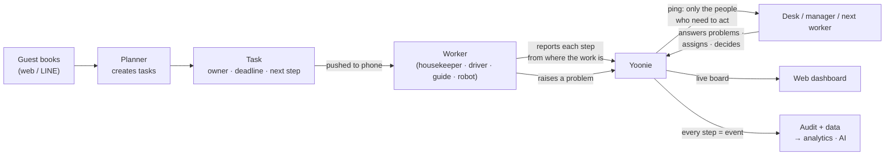
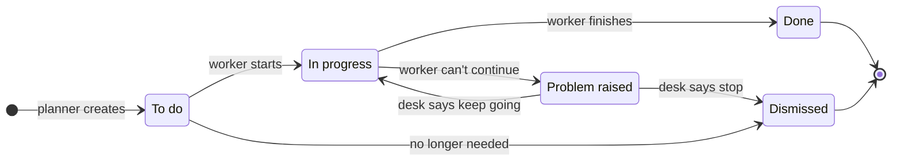
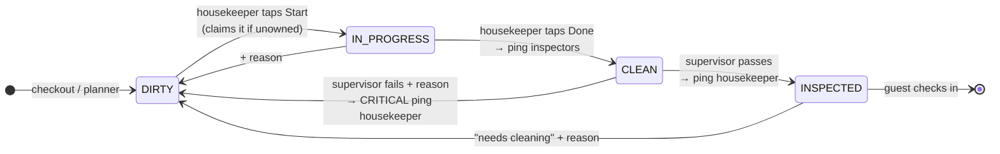
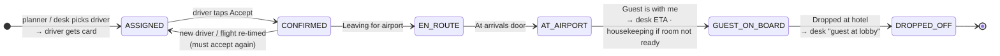
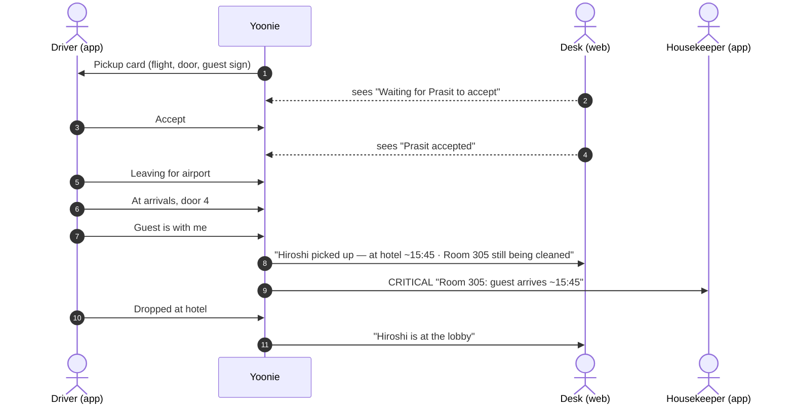
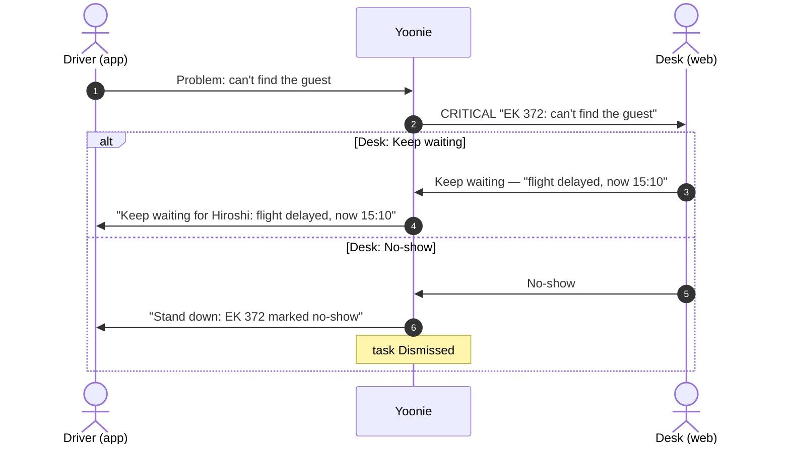
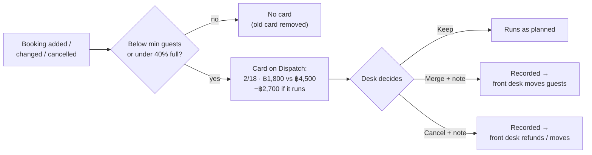
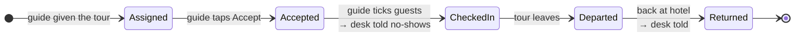
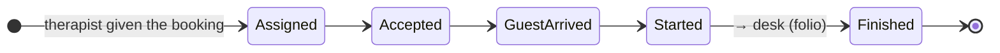

# Yoonie Operating Rules

The business logic every dispatched job in Yoonie must follow. Humans now, robots later. Web, staff app, backend and AI all follow these rules.

This is the rulebook. Where another doc or a screen disagrees with it, this document wins, and the other one gets fixed. `SYSTEM_FLOWS.md` §3 Flow 4 and Phases 3–4 describe the older direct-patch model (`PATCH /rooms/:id/cleaning`, `PATCH /dispatch/:id/status`). That model is retired; see §9.

Each rule is tagged with its status:

- **[Built]**: enforced in code today, with the file named.
- **[Partial]**: some of it is enforced; the gap is described.
- **[Not built]**: the rule is agreed but not built yet. Default values are proposals until they become branch settings.

---

## 1. What Yoonie is operationally

Yoonie is an operating system that **dispatches workers to perform tasks for guests**. A worker is a housekeeper, a driver, a guide or a therapist, and later a robot. Every task is visible to everyone who needs it, the moment it changes, across the web dashboard and the staff app. The trail it leaves is structured enough for software (and AI) to analyse, predict and eventually run parts of the hotel on its own. The business owner can see why each decision was made.

Three outcomes we're accountable for:

1. **The guest commitment is met.** The room is ready when the guest walks in, the van is at the door when the flight lands, and the tour leaves on time.
2. **Nothing happens blindly.** Every task has an owner, a deadline, a next step and an escalation path. Every change pings the right people, and only them.
3. **Everything is evidence.** Each step is a timestamped, structured event with a known actor. That's what makes analytics, AI and automation possible.

### The loop, in one picture

Workers report. Yoonie routes. The desk answers. Everything is recorded.

---

## 2. The laws

These apply to every job type, present and future. A feature that breaks one is a bug, even if it "works".

### L1. Truth comes from the worker doing the job
State changes are reported by the actor doing the work, from where the work happens (the room, the van, the arrivals door). Screens observe; they do not declare work done.

- The desk can **record a step on a worker's behalf** (the driver phoned in, the phone died). The step is stored with who recorded it and the note `Recorded by <name> for the driver`. It is never presented as the worker's own report. **[Built: pickups]** (`StaffService.recordPickupStep`). **[Not built: rooms]**: web Dispatch still has direct "Start cleaning" and "Mark clean" buttons for managers.
- A clean status a worker never reported isn't trustworthy, so reports should come from the worker.

### L2. One fact, one owner, one write path
Each fact lives in exactly one place and changes through exactly one service method.

| Fact | Lives on | Only changed by |
|---|---|---|
| Room readiness (`cleaningStatus`) | `Room` | `StaffService.transitionRoom` **[Built]** |
| Turnaround task status and owner | `OperationalDispatch` | the same `transitionRoom`, plus `claim` and `assign` **[Built]** |
| Pickup step | `OperationalDispatch.pickup.stage` | `recordPickupStep`, `claim`, `assign` and the planner **[Built]** |
| Tour fill decision | `OperationalDispatch.consolidation.decision` | `DispatchService.decideTour` **[Built]** |
| Sellable capacity | `InventorySlot` | the atomic `$inc` (see `PRODUCT.md` §5) **[Built]** |

`PATCH /dispatch/:id/status` refuses room turnarounds with 409 and refuses `ACKNOWLEDGED` with 400. `PATCH /rooms/:id` no longer accepts `cleaningStatus`. **[Built]**

### L3. Every task is accountable
A task must always answer five questions. A task that can't answer them shouldn't exist.

1. **Who has it?** A named owner, or the **open pool** for its role. In the pool the first worker to start claims it. "Nobody" is never a valid answer.
2. **By when?** A deadline derived from a guest commitment (§5), or explicitly "anytime today".
3. **What's next?** Exactly one next step for the worker.
4. **Where is it?** The current step, with the time it was reached.
5. **What if it goes wrong?** A structured way to raise a problem, and someone who must answer it (L5).

### L4. Every change pings the right people, and only them
Every state change produces a stored event (audit log) and, if it matters to someone else, a notification. Notifications follow the routing matrix (§6): never "everyone", never nobody when someone is waiting.

- Notifications are created as `PENDING` through `NotificationsService.createNotification`. The worker delivers them by push or LINE, and they always land in the inbox. **[Built]** Delivery needs `WORKER_ENABLED`.
- The actor is never notified about their own action. **[Built]**
- The API response tells the caller who was notified (`notified: string[]`), so the screen can say so. Silence is never ambiguous. **[Built: room moves, assign, pickup steps, problem reports and answers]**

### L5. Problems are first-class, and someone must answer them
A worker who can't proceed raises a **structured issue** (a kind from a fixed list, plus an optional note), not a phone call into the void.

- The issue alerts the desk at CRITICAL severity and shows on every screen.
- The desk **must answer** with a structured resolution (for example *Keep waiting* or *No-show*). The answer is pushed back to the worker.
- If the worker moves on to the next step, the issue is closed automatically as `CONTINUED`.
- **[Built: pickups]**. **[Not built: rooms, tours, spa]**. **[Not built: escalation]**, meaning an unanswered issue escalating to the manager (§7).

### L6. Steps only move forward and every step is replay-safe
Workers are often offline (the basement, the airport car park). The staff app queues actions and replays them later.

- Repeating a step, or "moving" to an earlier one, is a 200 no-op. Never an error, never a regression. **[Built]** (room transitions, pickup steps)
- The only way back is an explicit, reasoned action, such as *Needs cleaning* or *Fail inspection*. These require a reason. **[Built]**
- Mutating endpoints accept an `Idempotency-Key`. **[Built]** (staff endpoints)

### L7. Structured first, free text second
Every state, kind, reason and decision is an **enum**. Free text is allowed only as a `note` attached to a structured value. That's what lets us count, compare, predict and automate. A new reason that keeps showing up in notes becomes a new enum value.

### L8. Humans decide anything that costs money or touches a guest
Cancelling a departure, declaring a no-show, refunding and moving a guest are **decisions**. A person makes them and they are recorded: `decision`, `note`, actor and time. AI and rules may **recommend** (for example "MERGE_OR_CANCEL") but don't act until a rule has been explicitly approved for automation, per branch (§8).

### L9. Workers are interchangeable; the task contract isn't
A task doesn't care whether a human or a robot does it. Any actor that can report the task's steps and raise its issues can be assigned it. Capabilities and roles decide *who may*, and the task contract decides *what happens*. **[Not built]** No capability model yet; roles and job titles stand in for it today.

### L10. Branches are walls
A worker sees and acts only within their branches. An assignee must belong to the task's branch. Platform admins are the only exception. **[Built]** (`validateBranchAccess`, assignment branch check, STAFF branch check on status updates)

### Carried over from `PRODUCT.md` §5 (still in force)
- Room ≠ availability. Selling goes through `InventorySlot` only.
- One atomic `$inc` concurrency model for every sellable unit.
- Task generation is idempotent: a natural-key upsert on `{branchId, serviceDate, type, dedupeKey}`.
- Every order is attributable (UTM and channel).
- Business dates are stored as `YYYY-MM-DD` next to UTC timestamps.

---

## 3. Vocabulary

| Term | Meaning |
|---|---|
| **Task** | One unit of dispatched work (`OperationalDispatch`), for example "turn room 305" or "pick up EK 372". |
| **Job type** | What kind of task it is: `HOUSEKEEPING_TURNAROUND`, `AIRPORT_PICKUP`, `TOUR_CONSOLIDATION`, and in future `TOUR_DEPARTURE` and `SPA_SESSION`. |
| **Stage / step** | Where the work physically is. Each job type defines its own ordered stages. A *step* is a recorded arrival at a stage: `{stage, at, byUserId, byName, note}`. |
| **Status** | The coarse, shared lifecycle every task has, derived from the stage: **To do** (`OPEN`), **In progress**, **Done**, **Dismissed**. `ACKNOWLEDGED` is retired: it stays readable for old rows and is never written. |
| **Owner / pool** | The assignee (`assigneeUserId`), or none, which means it's open to the pool for that job's role. |
| **Claim** | A worker taking a pool task. Starting work on an unowned task claims it automatically. |
| **Assign** | The desk giving a task to a named worker, or back to the pool. |
| **Desk** | Whoever coordinates: `BRANCH_MGR`, `DISPATCHER`, and STAFF whose job title matches front desk, reception or concierge. |
| **Issue** | A structured problem raised by the worker (L5). |
| **Answer** | The desk's structured resolution of an issue. |
| **Commitment** | The guest-facing promise a deadline comes from: an arrival ETA, a flight landing or a departure time. |
| **Ping** | A notification created for a person (inbox, push or LINE). |

---

## 4. Job types

### Who does each job

| Job | Who does it | Who watches / decides | Exists in Yoonie today? |
|---|---|---|---|
| 4.1 Room turnaround | **Housekeeper** (Noi, Dao) | Supervisor inspects; desk watches | Yes |
| 4.2 Airport pickup | **Driver** (Somchai, Prasit) | Desk answers problems | Yes |
| 4.3 Tour fill check | **Nobody does work.** It's a money decision. | **Desk / manager** decides Keep, Merge or Cancel | Yes |
| 4.4 Tour departure | **Tour guide** | Desk | **No.** There are no guides in Yoonie (no `GUIDE` job title, no guide accounts). |
| 4.5 Spa session | **Therapist** | Desk / spa reception | **No.** Spa only stores "N therapists" as a number, not people. |

**Open question for 4.4 and 4.5:** are guides and therapists our staff, or a partner company's? If they're ours, they get accounts like drivers. If they're a partner's, they need a no-login link to tap steps. We need the answer before building either.

### Every task, the same lifecycle

Ownership (assign / claim) can change any time before Done. Each job type defines its own **steps** inside *In progress*. The shared status (To do / In progress / Done / Dismissed) is derived from the step and never set directly.

### 4.1 Room turnaround: `HOUSEKEEPING_TURNAROUND`

**Purpose:** a room is inspected and ready before its guest walks in.

**Created** **[Built]**:
- by the planner when a stay is booked: dedupe key `hk:<roomNumber>` on the check-in date (`DispatchPlannerService.planTurnaround`);
- by `ensureTurnarounds` for every non-ready room that has no task, whenever today's Dispatch or staff task list is loaded.

So departures and stayovers get a task too.

**Stages** (the room's `cleaningStatus`; the task status follows) **[Built]**:

| Room | Task | Who may move it there |
|---|---|---|
| `DIRTY` | To do | anyone, from any state, **with a reason** (*Needs cleaning*, *Fail inspection*) |
| `IN_PROGRESS` | In progress | the housekeeper. Starting an unowned room claims it. |
| `CLEAN` | Done (waiting for inspection) | the housekeeper |
| `INSPECTED` | Done | BRANCH_MGR, ADMIN, or anyone with `housekeeping:inspect` |

Allowed moves: `DIRTY→IN_PROGRESS→CLEAN→INSPECTED`, and `any→DIRTY` with a reason. Anything else is 409.

**Ownership** **[Built]**:
- Open pool for housekeepers. Starting a room claims it.
- Another housekeeper acting on a claimed room gets 403 "Another housekeeper has claimed this room".
- Managers can act on any room and can assign.

**Deadline** **[Built]**:
- `readyBy = ETA + 60 min` (`READY_BUFFER_MS`).
- ETA is the transfer flight's landing time if the guest has a transfer landing on check-in day; otherwise it's the branch `checkInTime`.
- When the driver reports **guest on board**, the room's ETA becomes `now + 45 min` and `readyBy` tightens to it if that's earlier.
- *Open question:* with the check-in-time ETA this yields 15:00 for a 14:00 check-in. Should the check-in-time case use `readyBy = checkInTime` with no buffer?

**Priority** **[Built]**: `housekeepingPriority(eta, isVip)`. Earliest arrival first; a VIP wins ties within 50 minutes. Rooms with no arrival sort last.

**Pings** are listed in §6.

**Gaps (agreed, not built):**
- **Can't clean** issues on the housekeeper's phone: `GUEST_IN_ROOM` (DND / guest present), `MAINTENANCE_NEEDED`, `OUT_OF_SUPPLIES` and `OTHER`. The desk answers with *Retry later (time)*, *Moved guest* or *Maintenance sent*. (L5)
- **Inspection from the supervisor's phone**, in the room. Web Pass/Fail becomes the fallback.
- **Remove the direct web buttons.** Replace web "Start cleaning / Mark clean" with "Housekeeper phoned in…", recorded on their behalf. (L1)
- **Track how long cleaning takes:** show "cleaning for 32 min" against `WORK_LEFT_MIN` estimates (DIRTY 45, IN_PROGRESS 25, CLEAN 10). Replace the estimates with measured medians per room type once there's data.

### 4.2 Airport pickup: `AIRPORT_PICKUP`

**Purpose:** a driver is at the arrivals door with a name sign when the guest comes out, and the hotel knows when the guest will walk in.

**Created** **[Built]**:
- by the planner from a transfer line with flight details: dedupe key `pickup:<orderId>:<lineId>`, on the landing date;
- by re-planning when the flight is edited. A pickup left on an old date is dismissed.

**Stages**, reported by the driver from the app (`POST /staff/pickups/:id/step`) **[Built]**:

| Stage | Driver taps | Task status |
|---|---|---|
| `ASSIGNED` | — (the desk or planner picked the driver) | To do |
| `CONFIRMED` | "Accept pickup" | To do |
| `EN_ROUTE` | "Leaving for the airport" | In progress |
| `AT_AIRPORT` | "At arrivals, door N" | In progress |
| `GUEST_ON_BOARD` | "Guest is with me" | In progress |
| `DROPPED_OFF` | "Dropped at the hotel" | Done |

**When something goes wrong:**

**Rules** **[Built]**:
- Forward only. Repeats and backwards moves are no-ops (L6).
- Skipping forward is allowed, for a driver who forgot to tap, and only the reached stage is recorded.
- A pickup with no driver can't move: 409 "Assign a driver first".
- Assigning a **different** driver before `EN_ROUTE` resets the stage to `ASSIGNED`, so the new driver must accept.
- A driver claiming from the pool counts as accepting (`CONFIRMED`).
- Re-timing the flight after acceptance resets the stage to `ASSIGNED`: "Flight re-timed to HH:MM — driver to accept again".
- Re-planning keeps the steps and any open issue. The planner never wipes the journey.
- Legacy app builds: `/start` maps to `EN_ROUTE` and `/done` maps to `DROPPED_OFF`.

**Issues** (`POST /staff/pickups/:id/issue`) **[Built]**:
- Kinds: `FLIGHT_DELAYED`, `GUEST_NOT_FOUND`, `VEHICLE_PROBLEM`, `OTHER`.
- Raising one sets severity CRITICAL and alerts the desk.
- The desk answers (`POST /dispatch/:id/pickup-issue`):
  - `KEEP_WAITING` (note = instructions): the driver is pinged.
  - `NO_SHOW`: the task is Dismissed and the driver is told to stand down.
- Moving to the next step auto-resolves the issue as `CONTINUED`.

**Deadline** **[Built]**:
- Due at landing (`etaAt`).
- It's judged Tight if the 60-minute drive to the airport no longer fits before landing and the driver hasn't left.
- After `GUEST_ON_BOARD` the countdown stops.

**Constants:**
- `AIRPORT_TO_HOTEL_MIN = 45` (`common/enums/pickup.enum.ts`) **[Built]**. It should become a branch setting **[Not built]**.

**Gaps:**
- Escalate an unaccepted pickup (§7).
- Let the driver add a note to an issue in the app; today they pick a kind only.
- Live flight status feed (planned in `PRODUCT.md`).
- Message the guest at `AT_AIRPORT` ("Your driver is at door 4") through their channel (`pickup.channel`).

### 4.3 Tour fill check: `TOUR_CONSOLIDATION` [Built]

**In one line:** a warning that a tour departure will lose money, so someone decides what to do *before* it runs.

**Who:** no worker. The **desk or manager** reads the card and decides.

**Example:** Sunset Cruise, 18:00. It costs the hotel ฿4,500 to run (boat and guide).

| | Booked | Revenue | Cost | Result | Flag? |
|---|---|---|---|---|---|
| Healthy | 10 / 18 | 10 × ฿900 = ฿9,000 | ฿4,500 | **+฿4,500** | No |
| Weak | 5 / 18 | ฿4,500 | ฿4,500 | ฿0 (break-even) | **Yes**: fill 28% is below 40% |
| Losing | 2 / 18 | ฿1,800 | ฿4,500 | **−฿2,700** | **Yes**: below the minimum of 6 guests |

**When the card appears:** after any booking change on that departure, if **either**:

| Rule | Setting | Default |
|---|---|---|
| Fewer guests than the minimum | `minViablePax` on the tour | set per tour (e.g. 6) |
| Fill rate too low | `consolidationThreshold` on the branch | 40% |

If the departure fills up later, the card disappears on its own.

**The decision:**

| Choice | Meaning | What Yoonie does | What a person still does |
|---|---|---|---|
| **Keep** | Run it anyway (VIP on board, promo, etc.) | records it, card closes | nothing |
| **Merge** | Move these guests to another departure | records it + your note | front desk moves the bookings and tells the guests |
| **Cancel** | Don't run it | records it + your note | front desk refunds or moves the guests and tells them |

**Not built yet:**
- After Merge or Cancel, nothing reaches the affected guests. A person has to call them.
- There's no "decide by" deadline per branch (for example 4 hours before departure).
- Nobody is pinged when a card appears; it only shows on the board.

### 4.4 Tour departure: `TOUR_DEPARTURE` [Not built]

**In one line:** the guide runs the tour and taps where it is, just as a driver does for a pickup.

**Who:** **tour guide**, who doesn't exist in Yoonie yet (see the open question above).

**Why it's needed:** today nobody knows whether a tour actually left, who didn't show up, or when guests are back. Every point below is something the desk can't see today.

| Guide taps | Who gets told | Why it matters |
|---|---|---|
| **Accept** | desk sees "guide confirmed" | someone is actually running it |
| **Guests checked in** (ticks names) | desk: "2 no-shows: Room 105, 208" | front desk can call the missing guests |
| **Departed** | desk | tour left on time, or late |
| **Returned** | desk: "Sunset Cruise back, 8 guests" | dinner and room prep can plan around it |
| **Problem**: guest missing / vehicle / weather | desk, urgent | desk answers: *wait 10 min*, *leave without them*, or *cancel* (cancel is a manager decision) |

### 4.5 Spa session: `SPA_SESSION` [Not built]

**In one line:** the therapist taps through each treatment, so the desk knows the guest was seen and the room is free again.

**Who:** **therapist**, who doesn't exist in Yoonie yet. Spa only knows "3 therapists, 2 treatment rooms" as numbers, which is enough to stop overbooking but not to dispatch anyone.

| Therapist taps | Who gets told | Why it matters |
|---|---|---|
| **Accept** | desk | someone is covering the 15:00 massage |
| **Guest arrived** | — | starts the clock; if it isn't tapped by start time, the desk can call the guest |
| **Started** | — | the room is in use |
| **Finished** | desk (to charge the folio) | room free; extras can be added to the bill |
| **Problem**: guest late / room not ready | desk, urgent | desk answers: *shorten session*, *reschedule*, or *no-show* (charging a no-show is a manager decision) |

### 4.6 Before adding any new job type (checklist for builders)

This is not a feature. It's the list a developer must fill in **before** building a new kind of job (tour departures, spa, room service, robot deliveries). If a box can't be filled, the job isn't ready to build.

| # | Question | Pickup example |
|---|---|---|
| 1 | **Who does it?** Which role, and do they have an account? | Driver (STAFF, job title DRIVER) |
| 2 | **What do they tap?** As few steps as possible; every step must tell someone something (L4) | Today 5 taps; proposed 3: Accept · Guest with me · Dropped off |
| 3 | **What can go wrong, and what can the desk answer?** | Can't find guest → Keep waiting / No-show |
| 4 | **What's the deadline, and which guest promise sets it?** | Flight landing time |
| 5 | **Who gets pinged at each step?** Add it to §6 | Desk at "guest with me" and "dropped off" |
| 6 | **How is it created, and can it be created twice?** One natural key, no duplicates | `pickup:<order>:<line>` |
| 7 | **Is it safe offline?** Repeating a tap does nothing | Yes, forward-only |
| 8 | **Is it written here?** Add a section to this doc in the same PR | §4.2 |

---

## 5. Deadlines and urgency

Every task's deadline comes from a guest commitment. Urgency is computed the same way on every screen (`modules/ops/components/urgency.ts`) **[Built]**:

| Urgency | Rule |
|---|---|
| **Late** | the deadline has passed |
| **Tight** | minutes left < estimated work left + 15 min buffer |
| **On track** | otherwise |
| **Anytime** | no guest commitment today (for example a room with no arrival) |
| **Done** | finished or dismissed |

Work-left estimates are listed under each job type. Lists are sorted Late → Tight → On track → Anytime, then by minutes left, then by priority score.

---

## 6. Ping routing matrix

Who gets told what. "Desk" is defined in §3. The actor never gets their own ping.

| Event | Recipients | Severity | Status |
|---|---|---|---|
| Room → `CLEAN` | BRANCH_MGR, ADMIN, anyone with `housekeeping:inspect` | INFO | **[Built]** |
| Room → `DIRTY` (needs cleaning / failed inspection) | the room's owner, or the housekeeper pool if unowned | CRITICAL if it was CLEAN, otherwise WARN | **[Built]** |
| Room → `INSPECTED` | the housekeeper who owned it | INFO | **[Built]** |
| Room → `IN_PROGRESS` by someone other than its owner | the owner | INFO | **[Built]** |
| Task assigned to someone | the assignee (pickups get the pickup card as `PICKUP_READY`) | INFO, or WARN if critical | **[Built]** |
| Pickup created or flight re-timed | the assigned driver | INFO | **[Built]** |
| Pickup `GUEST_ON_BOARD` | desk: "<guest> picked up — at hotel ~HH:MM · Room N is …" | INFO if the room is ready, otherwise WARN | **[Built]** |
| Pickup `GUEST_ON_BOARD` and the room isn't inspected | the room's owner, or the housekeeper pool | CRITICAL | **[Built]** |
| Pickup `DROPPED_OFF` | desk: "<guest> is at the lobby" | INFO | **[Built]** |
| Pickup issue raised | desk | CRITICAL | **[Built]** |
| Pickup issue answered | the driver | INFO, or WARN for no-show | **[Built]** |
| Pickup not accepted 90 min before landing | desk, then the manager after 15 more min | WARN, then CRITICAL | **[Not built]** |
| Room will miss ready-by (Tight → Late) | the room's owner, then desk | WARN, then CRITICAL | **[Not built]** |
| Issue unanswered for 10 min | BRANCH_MGR | CRITICAL | **[Not built]** |
| Tour flag raised | desk | WARN or CRITICAL | **[Not built]** (only visible on the board today) |

Steps that only show on the board, with no ping: pickup `CONFIRMED`, `EN_ROUTE`, `AT_AIRPORT`; claims. The board updates live (15 s polling on web), and pinging these would be noise.

---

## 7. Escalation [Not built]

"Nothing happens blindly" also means **nothing waits silently**. These are proposed defaults; each becomes a branch setting:

| Condition | After | Escalate to |
|---|---|---|
| Pickup still `ASSIGNED` (not accepted) | 90 min before landing | desk; then BRANCH_MGR 15 min later |
| Pickup not `EN_ROUTE` | the drive time (60 min) before landing | desk, CRITICAL |
| Issue unanswered | 10 min | BRANCH_MGR |
| Room becomes Tight | the moment it happens | the room's owner (or pool) |
| Room becomes Late | the moment it happens | desk + BRANCH_MGR |
| Pool task unclaimed | 30 min before its Tight point | the role pool, then desk |

Escalations run from a scheduled sweep (the same pattern as the inventory sweeper). Each one is idempotent per task and threshold (`data.alertedAt`), so nobody gets pinged twice for the same thing.

---

## 8. Data, analytics and AI

### 8.1 What every task leaves behind [Built for pickups and rooms]
- **Steps:** `{stage, at, byUserId, byName, note}` in order. Rooms rely on the audit log `ROOM_TRANSITION` entries.
- **Issues and answers:** kind, note, time, who raised it, resolution, who resolved it, and when.
- **Audit log** (`AuditService`) of every mutation: who, action, target, from → to, metadata.
- **Decisions** (L8): enum + note + actor + time.

### 8.2 Metrics this enables
| Metric | Formula |
|---|---|
| Turnaround duration | `IN_PROGRESS → CLEAN` per room type and housekeeper |
| Inspection fail rate | `CLEAN → DIRTY` / `CLEAN → INSPECTED` |
| Ready-on-time rate | rooms `INSPECTED` before the guest's actual arrival |
| Driver acceptance latency | `ASSIGNED → CONFIRMED` |
| Door-on-time rate | `AT_AIRPORT` before landing |
| Airport → hotel actual | `GUEST_ON_BOARD → DROPPED_OFF`; this replaces the 45 min constant |
| No-show rate | per channel, flight origin, tour |
| Tour economics | fill rate, decision outcomes, realised loss |
| Issue mix | issue kind frequency per job type and branch: where operations break |

### 8.3 What AI may and may not do
- **May (now):** read the structured data above; summarise; flag risks ("3 rooms will be Tight by 14:00"); recommend an assignment, a merge or a staffing level; draft guest messages for a human to send.
- **May (after per-branch approval of a specific rule):** perform a specific action automatically, for example auto-assigning a pool room to the least-loaded housekeeper. The AI acts as a named system actor (`byName: "Yoonie AI"`) and goes through the same endpoints, rules and audit as a person. It never gets a side door.
- **May not:** make an L8 decision (money or guest impact) without an approved rule; mark work as done that a worker didn't report (L1); write free-text states (L7).

### 8.4 Robots
A robot is a worker whose app is an API client. It is assigned tasks the same way and reports the same steps and issues. Its actions are audited the same way. What changes is **who may**: capability flags on the worker (for example `can_deliver_amenities`, `can_vacuum`) decide which job types it can be assigned, and a human desk still answers its issues. **[Not built]** No capability model yet.

---

## 9. Retired behaviour (don't reintroduce)

| Retired | Why | Replaced by |
|---|---|---|
| `ACKNOWLEDGED` task status | It meant nothing: no one could tell what had been acknowledged. | Ownership via the assignee. Pickups have a real `CONFIRMED` stage. Tours have a recorded decision. |
| `PATCH /rooms/:id { cleaningStatus }` | It changed the room without its task. | `POST /staff/rooms/:id/transition` |
| `PATCH /dispatch/:id/status` for turnarounds | It changed the task without the room. | the same transition (returns 409 now) |
| Web "Start pickup / Guest picked up" | The desk declared work it didn't see (L1). | driver steps from the app; "Driver phoned in…" fallback |
| Separate Housekeeping page | It was a second place to do the same work. | Dispatch's Rooms lane (`/ops/housekeeping` redirects there) |

---

## 10. Roles (today)

| Role | Can |
|---|---|
| `STAFF` (housekeeper) | see their own rooms and the pool; claim by starting; move their room to `IN_PROGRESS` and `CLEAN`; send a room to `DIRTY` with a reason |
| `STAFF` (driver) | see their pickups; report steps and issues on their own pickups |
| `STAFF` with `housekeeping:inspect` | everything above, plus inspect (`INSPECTED`) |
| `DISPATCHER` | see Dispatch; assign; answer issues; record decisions; record pickup steps on a driver's behalf; can't move rooms |
| `BRANCH_MGR` / `ADMIN` | everything in their branches, including room moves and inspection |

Job titles (`HOUSEKEEPER`, `DRIVER`, front desk) currently stand in for capabilities (L9).
