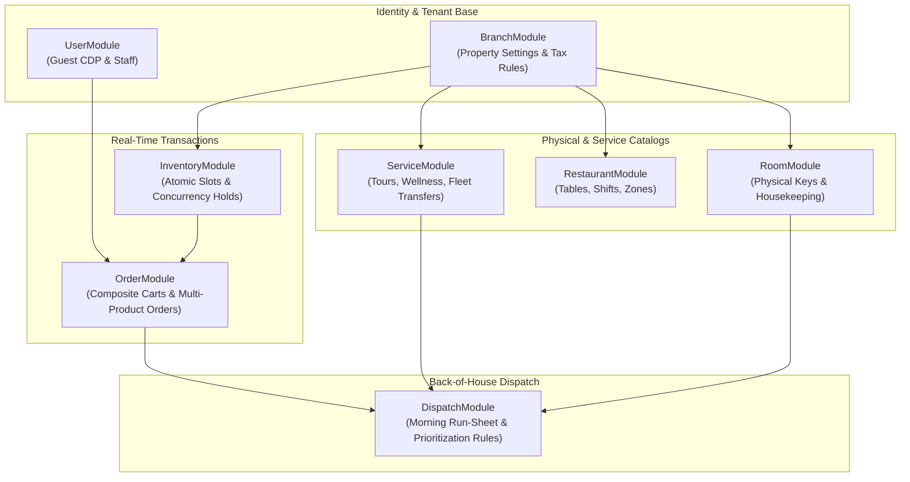
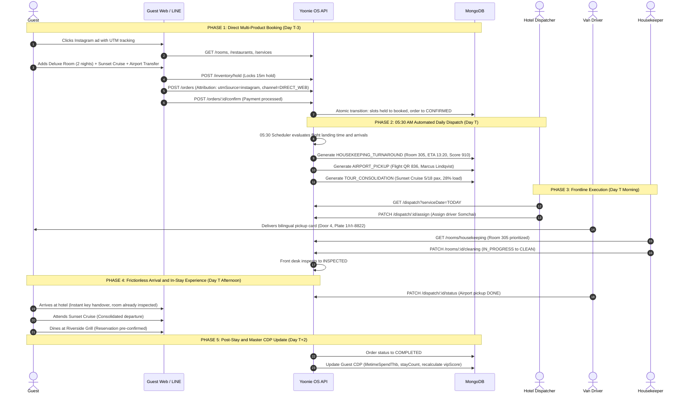
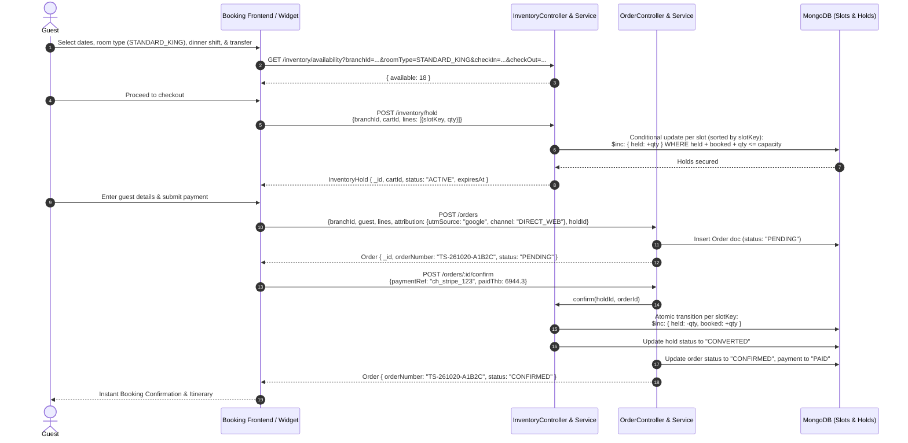
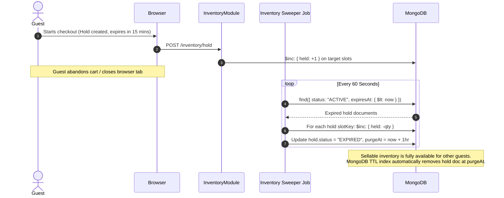
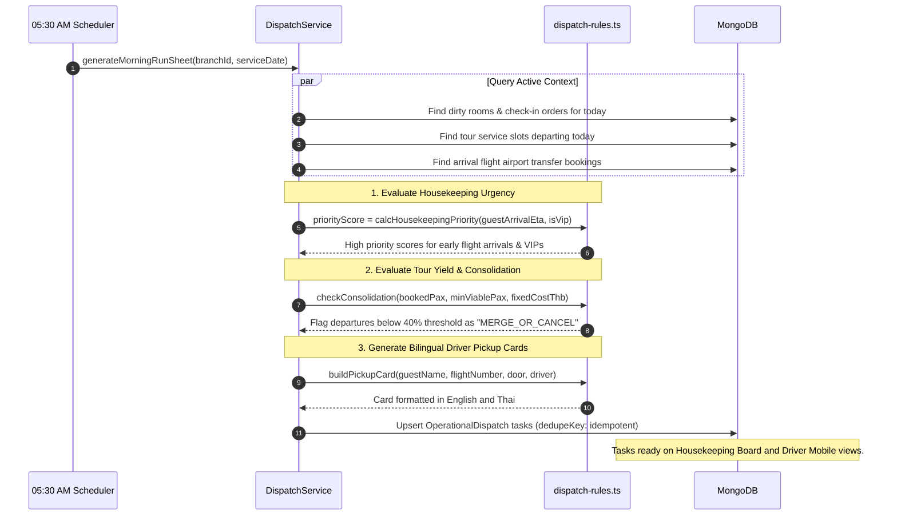
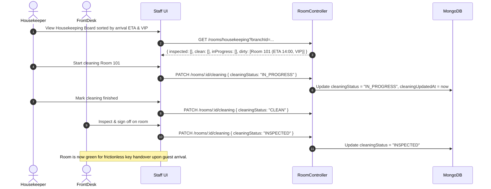

# System Architecture & Operational Flows

High-level architectural blueprint and sequence diagrams for the `yoonie-backend` hospitality operating system.

> **Out of date in places.** Phase 3–4 and Flow 4 show rooms and tasks being patched directly (`PATCH /rooms/:id/cleaning`, `PATCH /dispatch/:id/status`). That model is retired. Rooms move only through `POST /staff/rooms/:id/transition`, and pickups move through driver-reported steps. See [`OPERATING_RULES.md`](./OPERATING_RULES.md), which takes precedence.

---

## 1. Architecture & Domain Decoupling

The platform is designed around 7 bounded domain modules and 2 foundation modules, eliminating monolithic coupling.

### Module Responsibilities

1. **`BranchModule`**: Multi-tenant property root. Stores IANA timezones (`Asia/Bangkok`), local currency (`THB`), check-in/out times, tax rates (VAT 7%, Service Charge 10%), and dispatch timing rules.
2. **`UserModule`**: Unified profiles for guests and hotel staff. Stores guest CDP attributes (`lifetimeSpendThb`, `stayCount`, `lineUserId`, `phoneE164`, `vipScore`) alongside staff roles (`ADMIN`, `BRANCH_MGR`, `DISPATCHER`, `STAFF`).
3. **`RoomModule`**: Manages physical keys (`101`, `102`) and operational cleanliness (`CLEAN`, `DIRTY`, `IN_PROGRESS`, `INSPECTED`). **Never computes availability**.
4. **`RestaurantModule`**: F&B outlet configuration, table layouts, and meal shifts (`BREAKFAST`, `ALL_DAY`, `EVENING`).
5. **`ServiceModule`**: Catalog for excursions, spa treatments, and airport transfers with capacity thresholds and minimum viable pax (`minViablePax`).
6. **`InventoryModule`**: **The central sellable-capacity engine**. Manages time-slice inventory slots (`ROOM_NIGHT`, `DINING`, `SERVICE`) with engine-level atomic conditional increments (`$expr: { $lte: [{ $add: ['$held', '$booked', qty] }, '$capacity'] }`).
7. **`OrderModule`**: Composite customer bookings spanning multiple dates and services in a single cart. Collects direct attribution (`utmSource`, `utmCampaign`, `channel`).
8. **`DispatchModule`**: Back-of-house automated air-traffic controller. Evaluates live booking and flight data each morning at `05:30` to generate priority-ranked tasks for housekeeping, fleet drivers, and tour coordinators.

---

## 2. The 9 MongoDB Collections

| Collection | Model Class | Document Purpose | Concurrency / Mutation Strategy |
| :--- | :--- | :--- | :--- |
| `branches` | `Branch` | Single hotel property configuration & rules | Static property config |
| `users` | `User` | Unified staff roles & guest CDP profiles | Direct updates; sparse unique index on phone/Line ID |
| `rooms` | `Room` | Physical room keys, amenities, and cleaning status | Housekeeping status updates via staff patch |
| `restaurants` | `Restaurant` | Dining outlets, physical tables, and meal shifts | Static outlet config |
| `services` | `Service` | Tour, spa, and transfer product configurations | Static experience catalog |
| `inventory_slots` | `InventorySlot` | Exact bookable capacity unit per date/timeslot | **Atomic `$inc`** on `held` and `booked` |
| `inventory_holds` | `InventoryHold` | Temporary hold claimed during checkout | Managed via TTL indexes and periodic sweeper |
| `orders` | `Order` | Composite multi-item reservation (Stay + Dining + Tours) | Optimistic concurrency (`__v`), derived status |
| `operational_dispatches` | `OperationalDispatch` | Prioritized daily frontline tasks & run-sheets | Upserted idempotently on `dedupeKey` |

---

## 3. End-to-End Operational Lifecycle

### Master E2E Flow: The Unified Guest & Operations Journey
This diagram bridges pre-arrival direct booking, overnight dispatch calculation, and back-of-house frontline execution across all 5 operational phases.

| Phase | Actors Involved | Core Endpoints & Payloads | Business Impact |
| :--- | :--- | :--- | :--- |
| **1. Direct Booking** | Guest, Booking Web | `GET /rooms`, `POST /inventory/hold`, `POST /orders`, `POST /orders/:id/confirm` | Locks inventory atomically without double-booking; captures marketing attribution |
| **2. Overnight Dispatch** | System Cron (`05:30`) | `generateMorningRunSheet()` (Internal engine) | Housekeeping prioritized by arrival ETA; tour occupancy economics evaluated |
| **3. Frontline Ops** | Dispatcher, Drivers, Housekeeping | `GET /dispatch`, `PATCH /dispatch/:id/assign`, `GET /rooms/housekeeping`, `PATCH /rooms/:id/cleaning` | Zero front-desk bottlenecks; bilingual pickup cards delivered to arriving guests |
| **4. In-Stay Experience** | Guest, Front Desk, F&B Staff | `PATCH /dispatch/:id/status`, `GET /orders/:id` | Room inspected before arrival; dining and excursions fulfilled from one folio |
| **5. Post-Stay & CDP** | GM, Marketing System | `PATCH /orders/:id/status`, `GET /users` | Lifetime spend & stay frequency recalculate VIP tiers for future direct marketing |

---

### Flow 1: Direct Guest Multi-Product Booking Journey
Guests select a room, dining shift, and airport transfer in one cart. Sellable inventory is held atomically during checkout and converted upon payment confirmation.

---

### Flow 2: Cart Abandonment & Automated Sweeper
If a customer leaves the checkout page without paying, the inventory hold automatically expires and capacity is restored to the open selling pool.

---

### Flow 3: 05:30 AM Morning Dispatch Run-Sheet Generation
Every morning before frontline staff report for duty, the dispatch engine evaluates active bookings and logistics to produce prioritized task cards.

---

### Flow 4: Housekeeping Front-Desk Zero Flow
Rooms are cleaned in order of guest arrival logistics rather than numeric order.

